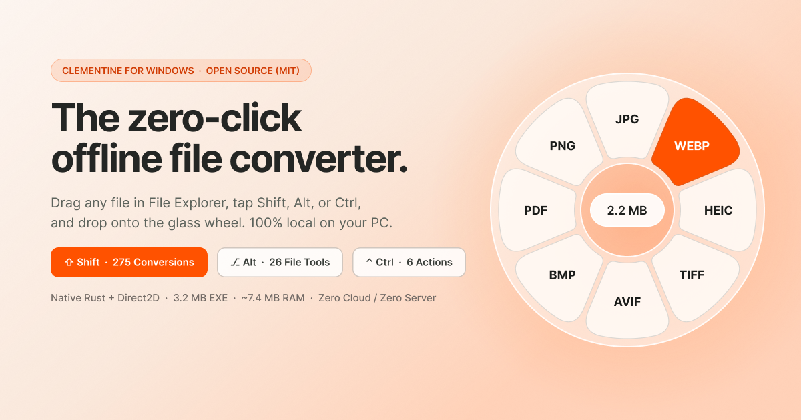
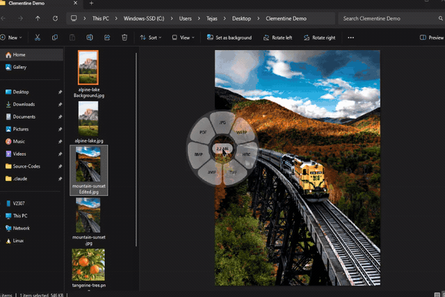
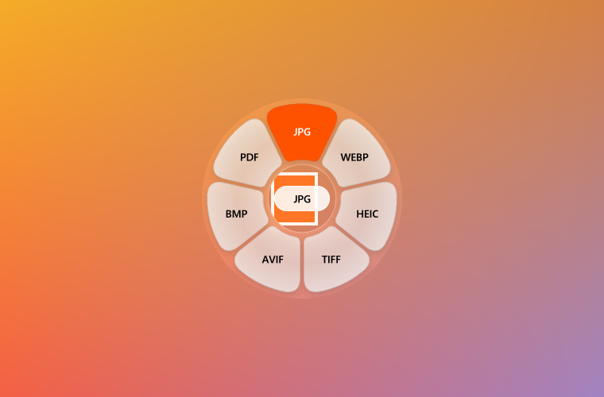
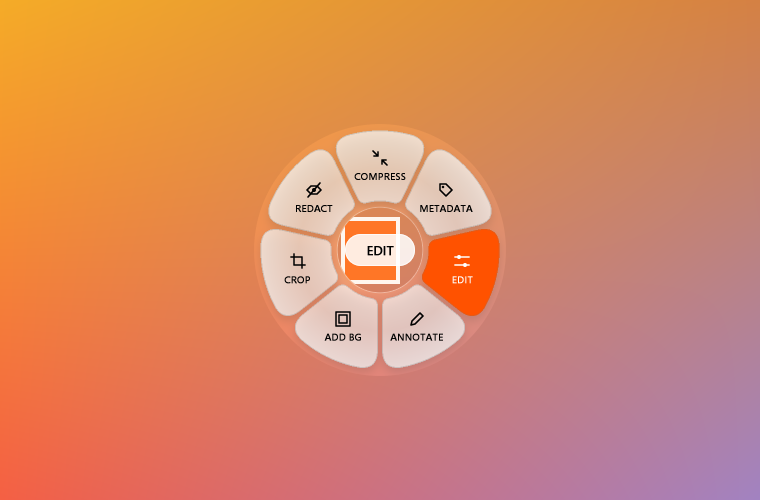
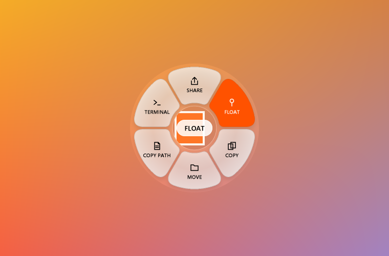

#  Clementine for Windows

<p align="center">
  
</p>

**Clementine** is a zero-click, offline file converter, 26-tool file suite, and 6-action radial wheel for Windows 10 & 11. Drag any file in File Explorer, tap a modifier key (`Shift`, `Alt`, or `Ctrl`), and drop it onto a glass petal. Everything runs 100% locally in a single `3.3 MB` native Rust + Win32 executable using `~7.5 MB` of RAM with zero background servers and zero telemetry.

<p align="center">
  <a href="https://tejaslamba2006.github.io/clementine/"><strong>Live Interactive Website & Playground</strong></a> ·
  <a href="https://github.com/TejasLamba2006/clementine/releases/latest/download/Clementine-Setup.exe"><strong>Download Clementine-Setup.exe (Installer)</strong></a> ·
  <a href="https://github.com/TejasLamba2006/clementine/releases/latest"><strong>Portable EXE & Releases</strong></a>
</p>

---

## Live Desktop Captures (Windows 11)

<p align="center">
  
</p>

<p align="center">
  
  
  
</p>

| Modifier Key | Radial Wheel | What It Does |
| :--- | :--- | :--- |
| **`Shift`** | **Convert (`275` paths)** | Convert between image, audio, video, PDF, document, presentation, spreadsheet, subtitle, and archive formats |
| **`Alt`** | **File Tools (`26` tools)** | Compress, strip metadata, edit/annotate/frame/crop/redact photos, collage, trim/crop/speed/join/split/mute video, normalize/trim/bleep audio, merge/split/organize PDFs, extract archives |
| **`Ctrl`** | **File Actions (`6` actions)** | Nearby Share, Float (pinned screen-edge shelf), Copy (`CF_HDROP`), Move, Copy Path, Open in Windows Terminal / PowerShell |

---

## Install as a Windows Program (Auto-Runs at Startup)

### Option 1: One-Click Installer (`Clementine-Setup.exe`)
Download and run [**`Clementine-Setup.exe`**](https://github.com/TejasLamba2006/clementine/releases/latest/download/Clementine-Setup.exe). It automatically:
1. Installs Clementine to `%LOCALAPPDATA%\Programs\Clementine\Clementine.exe` (no UAC admin prompt required).
2. Creates the **Clementine** shortcut with its custom icon in your **Windows Start Menu** (`%APPDATA%\Microsoft\Windows\Start Menu\Programs\Clementine.lnk`).
3. Registers Clementine to **start automatically at Windows login** (`HKCU\Software\Microsoft\Windows\CurrentVersion\Run`).
4. Registers Clementine in **Windows Settings -> Apps -> Installed apps** for clean one-click uninstall.
5. Launches Clementine in your System Tray (right-click the Clementine tray icon anytime to toggle **Run at Windows Startup**, open the **Floating Shelf**, or launch the **Demo Wheel**).

### Option 2: Portable CLI / Manual Install
```powershell
clementine.exe --install        # Install to Start Menu, Installed Apps, and enable Run at Startup
clementine.exe --uninstall      # Remove Start Menu shortcut, Startup entry, and Installed Apps registration
clementine.exe                  # Run in System Tray with background drag hooks
clementine.exe --demo           # Pop open the interactive radial wheel on desktop
clementine.exe --live-Tour      # Run automated desktop showcase across all 3 wheels
clementine.exe --self-test      # Verify rendering pipeline and <15 MB Working Set budget
clementine.exe --convert <input_path> <target_ext>
```

---

## Architecture & Memory Footprint

| Metric | Value |
| :--- | :--- |
| **Executable Size** | `3.3 MB` standalone native PE (`clementine.exe`) |
| **Working Set RAM** | `~7.5 MB` (verified via `K32GetProcessMemoryInfo`) |
| **Background Server** | `0 MB` (none; all conversions run in-process or via ephemeral sidecar) |
| **Telemetry / Network** | `None` (zero network dependencies, 100% offline) |

- **`crates/clementine-core`**: Pure Rust conversion matrix (`275` conversion paths, `26` tools, `6` actions), exact `272x272` radial petal geometry (`inner = 48.64`, `outer = 119.52`, `backdrop = 125.92`, `hole = 42.24`, `gap = 4.0`, `corner = 20.16`), `cubic-bezier(0.18, 0.82, 0.24, 1)` bloom easing, collision-safe sibling file naming, and local converters for images, PDFs, DOCX/XLSX, Markdown/HTML, CSV/TSV, SRT/VTT, ZIP/TAR/GZIP, and FFmpeg media.
- **`crates/clementine-win`**: Win32 per-pixel alpha layered overlay (`UpdateLayeredWindow`), real-time desktop backdrop capture with separable Gaussian blur (`radius = 16`) + `1.45x` saturation boost, `3x` supersampled typography, `4x` supersampled `18x18` vector tool icons, low-level mouse/keyboard drag hooks (`WH_MOUSE_LL`, `WH_KEYBOARD_LL`), COM `IDropTarget`, Floating Shelf window, and Windows Setup/Startup installer.
- **`web/`**: Interactive web playground and documentation deployed on GitHub Pages at <https://tejaslamba2006.github.io/clementine/>.

---

## Supported Formats & Tools

| Category | Supported Formats & Tools |
| :--- | :--- |
| **Images** | `JPG`, `PNG`, `WebP`, `HEIC`, `TIFF`, `AVIF`, `BMP`, `PDF` export, `SVG` input |
| **Audio** | `MP3`, `M4A`, `WAV`, `FLAC`, `OGG`, `Opus`, `AIFF`, `WMA` |
| **Video** | `MP4`, `MOV`, `MKV`, `WebM`, `AVI`, `WMV`, `GIF`, `MP3` audio extraction |
| **PDF** | `PDF` to `DOCX`, `PPTX`, `XLSX`, `JPG` (300 DPI), `PNG` (300 DPI), `EPUB`, `TXT`, `MD` + `Split PDF`, `Merge PDFs`, `Organize PDF` |
| **Documents** | `DOCX`, `Markdown`, `TXT`, `EPUB`, `RTF` input, `HTML` & `PDF` export |
| **Spreadsheets** | `XLSX`, `ODS`, `CSV`, `TSV`, `PDF` export |
| **Subtitles** | `SRT` <-> `VTT`, `TXT` transcript export |
| **Archives** | `ZIP`, `TAR`, `GZIP` (`.tar.gz`), `Extract Archive` |

---

## Build from Source

```powershell
cargo test --workspace
cargo build --release
# Output: target\release\clementine.exe
```

## License

MIT License. Built by [Tejas Lamba](https://github.com/TejasLamba2006).
