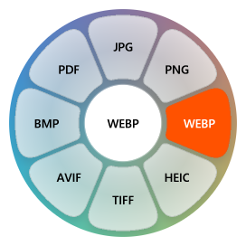
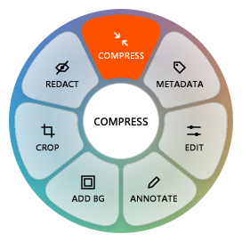
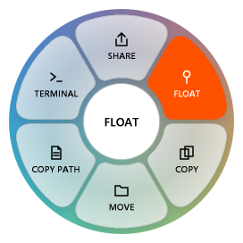

# Clementine

Zero-click, offline file converter for Windows. Drag a file, tap a modifier key, drop it on the radial wheel. Nothing is uploaded, ever.

| Key | Wheel | What it does |
|-----|-------|--------------|
| `Shift` | Convert | Convert to another format |
| `Alt` | File tools | Compress, crop, trim, split, merge, and more (26 tools) |
| `Ctrl` | File actions | Nearby Share, Float, Copy, Move, Copy Path, Terminal (6 actions) |

<p>
  
  
  
</p>

Website and live playground: open [`web/index.html`](web/index.html) (or serve `web/` with any static server).

## Architecture

- Rust workspace with two crates: `clementine-core` (conversion engine, geometry, matrices) and `clementine-win` (Win32 shell).
- `clementine-win` draws the wheel as a layered, per-pixel-alpha Win32 overlay rendered with Direct2D, with supersampled text.
- Global low-level hooks watch for a file drag plus modifier keys. An `IDropTarget` receives the drop. A system tray icon provides the menu.
- Conversions run in-process. No helper service, no daemon, no network calls, no telemetry.

## Footprint

| Metric | Value |
|--------|-------|
| Working set | ~8 MB |
| Background server | 0 MB (none) |
| Telemetry | none |

## Conversions and tools

| Category | Formats / tools |
|----------|-----------------|
| Images | JPG, PNG, WebP, HEIC, TIFF, AVIF, BMP, PDF export, SVG input |
| Audio | MP3, M4A, WAV, FLAC, OGG, Opus, AIFF, WMA |
| Video | MP4, MOV, MKV, WebM, AVI, WMV, GIF, MP3 export |
| PDF | to DOCX, PPTX, XLSX, JPG, PNG, EPUB, TXT, MD |
| Documents | DOCX, Markdown, TXT, EPUB, HTML export |
| Slides | PPT/PPTX to PDF, JPG, PNG |
| Spreadsheets | XLSX, ODS, CSV, TSV, PDF export |
| Subtitles | SRT, VTT, TXT export |
| Archives | ZIP, TAR, GZIP, extract |
| Tools | Compress, edit metadata, edit/annotate/crop/redact photos, collage, background, trim/crop/speed/join/split/redact video, video frames, normalize/trim/bleep audio, audio channels, audio visualizer, merge/split/organize PDF, extract archive |

Per-tool details: [`web/tools.html`](web/tools.html).

## Usage

```powershell
clementine.exe                                   # run in the tray
clementine.exe --demo [conversions|tools|actions] # open a wheel without dragging
clementine.exe --self-test                       # render a wheel to target/self-test-wheel.png
clementine.exe --render-wheel out.png [mode] [ext] [highlight_idx]
clementine.exe --convert <input_path> <target_ext>
```

## Build

```powershell
cargo build --release
# binary: target\release\clementine.exe
```

Requires Rust (stable, MSVC toolchain) on Windows 10 or 11.

Install from releases: <https://github.com/TejasLamba2006/clementine/releases>, or `winget install Clementine`.

## License

MIT
